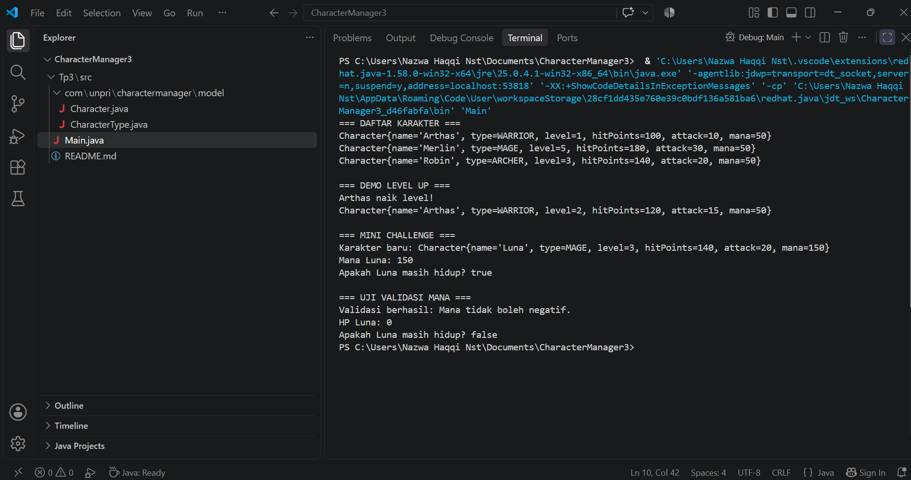

# Character Manager — TP3 (Java Visual SIH-6406)

## Deskripsi Project

Character Manager merupakan program sederhana berbasis Java yang digunakan untuk membuat dan mengelola data karakter. Program ini menerapkan konsep Object-Oriented Programming (OOP), seperti class, object, constructor, encapsulation, enum, getter, dan setter.

Pada tugas TP3 ini, program dikembangkan dengan menambahkan atribut mana, validasi mana, method `isAlive()`, serta pembaruan method `toString()` untuk menampilkan seluruh informasi karakter.

## Fitur Program

1. Membuat karakter menggunakan dua constructor.
2. Menggunakan enum `CharacterType` dengan empat tipe karakter.
3. Menggunakan encapsulation melalui atribut private.
4. Mengatur level karakter menggunakan setter.
5. Menghitung HP dan attack berdasarkan level.
6. Menambahkan atribut mana.
7. Memvalidasi agar mana tidak boleh bernilai negatif.
8. Memeriksa kondisi karakter menggunakan `isAlive()`.
9. Menampilkan informasi karakter melalui `toString()`.

## Teknologi yang Digunakan

- Bahasa pemrograman: Java
- JDK: 17
- Editor: Visual Studio Code
- Konsep: Object-Oriented Programming (OOP)

## Screenshot Output Program

Screenshot berikut menunjukkan hasil program ketika dijalankan melalui Terminal, termasuk demo level up, pengaturan mana, dan hasil pemeriksaan `isAlive()`.

Simpan screenshot terminal di folder `Screenshot` dengan nama `hasil-tp3.png`.

]

## Struktur Folder Project

```text
CharacterManager/
│
├── src/
│   ├── Main.java
│   │
│   └── com/
│       └── unpri/
│           └── charactermanager/
│               └── model/
│                   ├── Character.java
│                   └── CharacterType.java
│
├── Screenshot/
│   └── hasil-tp3.png
│
└── README.md
```

## Identitas Mahasiswa

- Nama: [Nazwa Haqqi Nasution]
- NIM: [253303621233]
- Tugas: TP3 - Character Manager Sprint #1

## Google Docs - Bagian D

Link Google Docs Analisis Desain dan Ekosistem Java:

[https://1drv.ms/w/c/4c356e610a8583e8/IQCYKV18ixjgQq-jCjRQLIO0AUXyxPV9f9E_LFuFEZ5ZZJU?e=2h8mZE]

## Kesimpulan

Melalui tugas TP3 ini, saya mempelajari cara membangun class Java dengan menerapkan konsep OOP. Saya juga memahami pentingnya encapsulation, constructor, enum, getter, setter, serta validasi data. Pengembangan atribut mana dan method `isAlive()` membuat program Character Manager memiliki fitur tambahan dan struktur kode yang lebih terorganisasi.

-------------------------------------------------------------------------------------------------

# Character Manager — TP5 (Java Visual SIH-6406)

## Deskripsi Project

Character Manager merupakan program sederhana berbasis Java yang digunakan untuk membuat dan mengelola data karakter. Pada tugas TP5 ini, program dikembangkan dengan menambahkan class `CharacterManager` untuk mengelola kumpulan karakter menggunakan ArrayList.

Program ini menerapkan konsep Object-Oriented Programming (OOP), seperti encapsulation, object reference, method equals(), defensive copy, dan static variable.

## Fitur Program

1. Membandingkan karakter berdasarkan nama menggunakan method `equals()`.
2. Menambahkan karakter menggunakan `addCharacter()`.
3. Mencari karakter berdasarkan nama menggunakan `findByName()`.
4. Menghapus karakter menggunakan `removeCharacter()`.
5. Menghitung jumlah karakter menggunakan `getTotalCharacters()`.
6. Mengembalikan salinan daftar karakter menggunakan `getAllCharacters()`.
7. Menolak penambahan karakter dengan nama duplikat.
8. Menghitung rata-rata level menggunakan `getAverageLevel()`.
9. Mencari karakter berdasarkan tipe menggunakan `findByType()`.
10. Menambahkan fitur analitik `findStrongest()` untuk mencari karakter dengan attack tertinggi.
11. Menggunakan `static variable` untuk menghitung jumlah objek Character yang dibuat.
12. Menguji object reference dan defensive copy.

## Teknologi yang Digunakan

- Bahasa pemrograman: Java
- JDK: 17
- Editor: Visual Studio Code
- Konsep: Object-Oriented Programming (OOP)
- Collection: ArrayList
- Materi: Encapsulation, Reference, Static, equals(), Defensive Copy

## Screenshot Output Program

Screenshot berikut menunjukkan hasil program ketika dijalankan melalui Terminal, termasuk pengujian tambah karakter, pencarian karakter, penolakan nama duplikat, perhitungan rata-rata level, pencarian berdasarkan tipe, dan fitur karakter terkuat.

()


## Struktur Folder Project

```text
CharacterManager/
│
├── src/
│   ├── Main.java
│   │
│   └── com/
│       └── unpri/
│           └── charactermanager/
│               └── model/
│                   ├── Character.java
│                   ├── CharacterType.java
│                   └── CharacterManager.java
│
├── Screenshot/
│   ├── output_tp3.png
│   ├── output_tp5.png
│   ├── reference_tp5.png
│   └── defensive_copy_tp5.png
│
└── README.md
```

## Identitas Mahasiswa

- Nama: Nazwa Haqqi Nasution
- NIM: 253303621233
- Tugas: TP5 - Character Manager Sprint #2
- Mata Kuliah: Java Visual (SIH-6406)
- Universitas: Universitas Prima Indonesia

## Google Docs - Bagian D

Link Google Docs Analisis Reference dan Rancangan:

[https://1drv.ms/w/c/4c356e610a8583e8/IQD_ktTceEe0S7WAN1kNpWD9ATDJ86gBn5r6vXC1dgJ42D8?e=UZCi0W]

## Kesimpulan

Melalui tugas TP5 ini, saya mempelajari cara mengelola kumpulan objek menggunakan CharacterManager dan ArrayList. Saya juga memahami perbedaan object reference dan primitive value, penggunaan static variable, method equals(), serta pentingnya defensive copy dalam menjaga encapsulation.

Selain itu, saya berhasil mengembangkan fitur analitik findStrongest() untuk mencari karakter dengan nilai attack tertinggi. Pengembangan ini membuat program Character Manager menjadi lebih lengkap, terstruktur, dan mudah dikembangkan.

--------------------------------------------------------------------------------------------------

# Character Manager — TP8 (Java Visual SIH-6406)

## Deskripsi Project

Character Manager merupakan program berbasis Java yang digunakan untuk membuat dan mengelola data karakter. Pada tugas TP8 ini, program dikembangkan dari aplikasi berbasis console menjadi aplikasi berbasis Graphical User Interface (GUI) menggunakan Java Swing.

Pengembangan ini menambahkan class MainWindow untuk menampilkan daftar karakter secara dinamis serta statistik rata-rata level karakter.

## Fitur Program

1. Menampilkan jendela aplikasi menggunakan JFrame.
2. Menggunakan MainWindow sebagai tampilan utama aplikasi.
3. Menampilkan data karakter secara dinamis menggunakan perulangan.
4. Menggunakan JPanel untuk menampilkan kartu karakter.
5. Menggunakan JScrollPane untuk memudahkan melihat daftar karakter.
6. Menampilkan nama, tipe, level, HP, attack, dan mana karakter.
7. Menampilkan statistik rata-rata level karakter.
8. Menampilkan jumlah seluruh karakter.
9. Memperbarui tampilan berdasarkan data dari CharacterManager.
10. Menggunakan SwingUtilities.invokeLater() untuk menjalankan GUI.

## Teknologi yang Digunakan

- Bahasa pemrograman: Java
- JDK: 17
- Editor: Visual Studio Code
- Library GUI: Java Swing
- Konsep: OOP, MVC, Event-Driven Programming
- Layout: BorderLayout dan BoxLayout

## Screenshot Output Program

### 1. Screenshot Sebelum Perubahan Data

Screenshot berikut menunjukkan tampilan MainWindow dengan lima karakter, yaitu Arthur, Merlin, Robin, Lancelot, dan Luna. Statistik rata-rata level yang ditampilkan adalah 3.00.

Simpan screenshot dengan nama `tp8_sebelum.png`.


### 2. Screenshot Sesudah Perubahan Data

Screenshot berikut menunjukkan tampilan MainWindow setelah penambahan karakter Thor dengan tipe WARRIOR dan level 10. Jumlah karakter menjadi enam dan rata-rata level berubah menjadi 4.17.

Simpan screenshot dengan nama `tp8_sesudah.png`.


## Analisis Aliran Data dan MVC

Pada project ini, Main.java bertugas membuat objek CharacterManager dan menambahkan data karakter. Setelah itu, Main.java memberikan objek CharacterManager kepada MainWindow melalui constructor.

MainWindow mengambil data karakter menggunakan method getAllCharacters() dari CharacterManager. Data tersebut kemudian ditampilkan secara dinamis menggunakan perulangan dan komponen JLabel di dalam JPanel.

CharacterManager berperan sebagai pengelola data atau bagian Model, sedangkan MainWindow berperan sebagai View yang menampilkan informasi kepada pengguna. Main.java mengatur proses pembuatan objek dan menghubungkan Model dengan View.

Dengan pembagian tersebut, pengelolaan data dan tampilan aplikasi menjadi lebih terorganisasi sesuai prinsip MVC.

## Karakter Baru

1. Lancelot — WARRIOR, Level 4. Dipilih sebagai karakter petarung dengan level lebih tinggi.
2. Luna — MAGE, Level 5. Dipilih sebagai karakter penyihir dengan level tertinggi pada pengujian awal.
3. Thor — WARRIOR, Level 10. Ditambahkan pada pengujian kedua untuk membuktikan perubahan statistik.

## Struktur Folder Project

```text
CharacterManager/
│
├── src/
│   └── com/
│       └── unpri/
│           └── charactermanager/
│               ├── Main.java
│               │
│               ├── model/
│               │   ├── Character.java
│               │   ├── CharacterType.java
│               │   └── CharacterManager.java
│               │
│               └── view/
│                   └── MainWindow.java
│
├── Screenshot/
│   ├── tp8_sebelum.png
│   └── tp8_sesudah.png
│
└── README.md
```

## Identitas Mahasiswa

- Nama: Nazwa Haqqi Nasution
- NIM: 253303621233
- Tugas: TP8 - Character Manager Sprint #3

## Google Docs - Bagian D

Link Google Docs Analisis GUI dan MVC:

https://1drv.ms/w/c/4c356e610a8583e8/IQCiMBFMTR7QRoDTrOisN0XrAcRuiMkQcj5-_er7068qFew?e=eWFF1g

## Kesimpulan

Melalui tugas TP8 ini, saya mempelajari cara mengembangkan aplikasi Java dari program console menjadi aplikasi GUI menggunakan Java Swing. Saya juga memahami penggunaan JFrame, JPanel, JLabel, JScrollPane, dan layout manager.

Selain itu, saya mempelajari konsep event-driven programming, penggunaan SwingUtilities.invokeLater(), serta hubungan antara Main, CharacterManager, dan MainWindow dalam penerapan prinsip MVC.

Dengan adanya tampilan data dinamis dan statistik rata-rata level, aplikasi Character Manager menjadi lebih interaktif dan mudah digunakan.