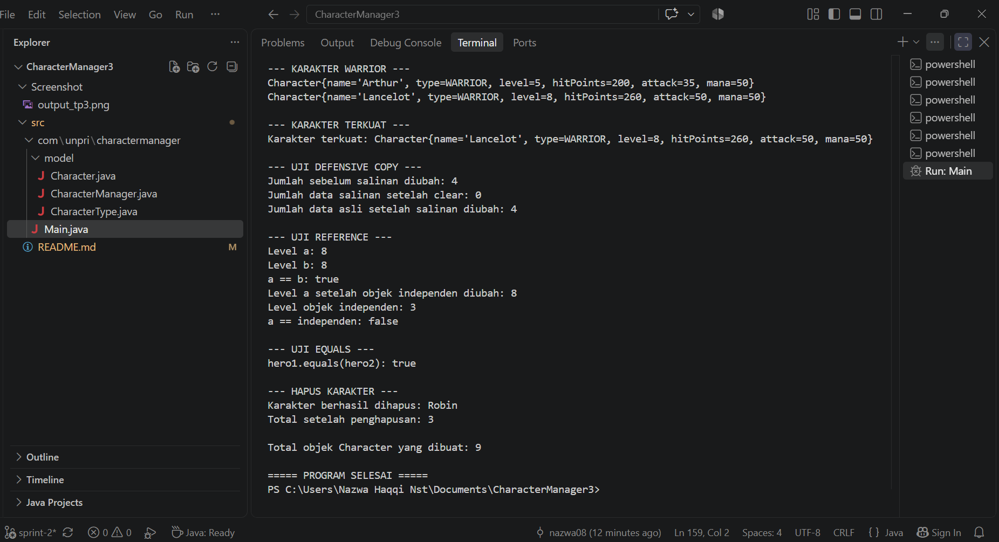
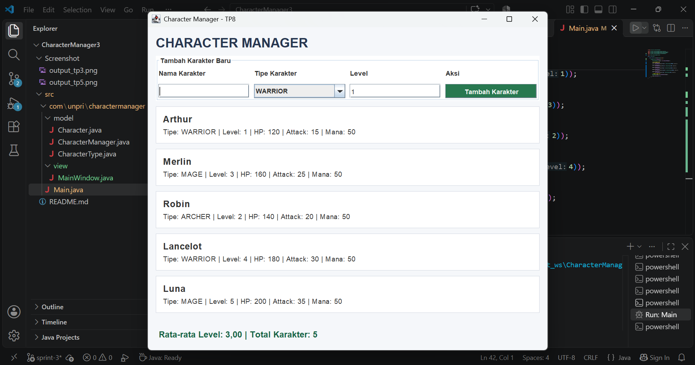
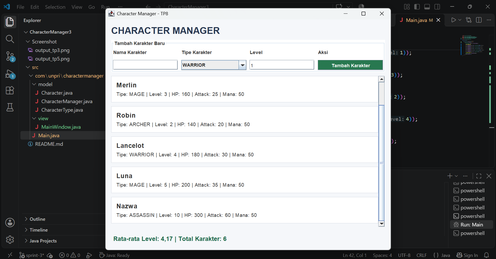
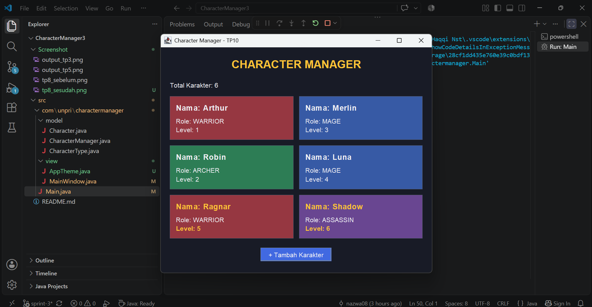
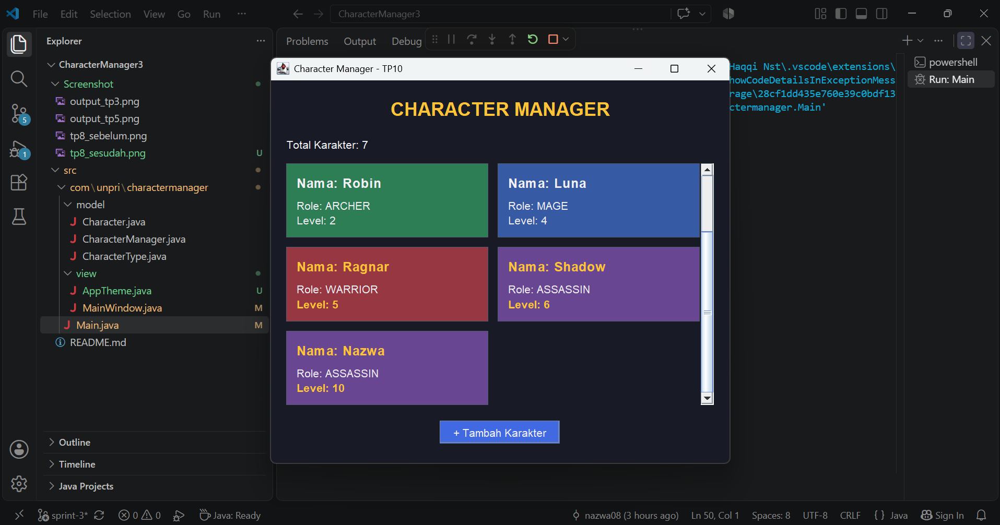

# Character Manager — TP3 (Java Visual SIH-6406)

## Deskripsi Project

Character Manager merupakan program sederhana berbasis Java yang digunakan untuk membuat dan mengelola data karakter. Program ini menerapkan konsep Object-Oriented Programming (OOP), seperti class, object, constructor, encapsulation, enum, getter, dan setter.

Pada tugas TP3 ini, program dikembangkan dengan menambahkan atribut mana, validasi mana, method `isAlive()`, serta pembaruan method `toString()` untuk menampilkan seluruh informasi karakter.

## Fitur Program

1. Membuat karakter menggunakan dua constructor.
2. Menggunakan enum `CharacterType` dengan empat tipe karakter.
3. Menggunakan encapsulation melalui atribut private.
4. Mengatur level karakter menggunakan setter.
5. Menghitung HP dan attack berdasarkan level.
6. Menambahkan atribut mana.
7. Memvalidasi agar mana tidak boleh bernilai negatif.
8. Memeriksa kondisi karakter menggunakan `isAlive()`.
9. Menampilkan informasi karakter melalui `toString()`.

## Teknologi yang Digunakan

- Bahasa pemrograman: Java
- JDK: 17
- Editor: Visual Studio Code
- Konsep: Object-Oriented Programming (OOP)

## Screenshot Output Program

Screenshot berikut menunjukkan hasil program ketika dijalankan melalui Terminal, termasuk demo level up, pengaturan mana, dan hasil pemeriksaan `isAlive()`.

Simpan screenshot terminal di folder `Screenshot` dengan nama `hasil-tp3.png`.

]

## Struktur Folder Project

```text
CharacterManager/
│
├── src/
│   ├── Main.java
│   │
│   └── com/
│       └── unpri/
│           └── charactermanager/
│               └── model/
│                   ├── Character.java
│                   └── CharacterType.java
│
├── Screenshot/
│   └── hasil-tp3.png
│
└── README.md
```

## Identitas Mahasiswa

- Nama: [Nazwa Haqqi Nasution]
- NIM: [253303621233]
- Tugas: TP3 - Character Manager Sprint #1

## Google Docs - Bagian D

Link Google Docs Analisis Desain dan Ekosistem Java:

[https://1drv.ms/w/c/4c356e610a8583e8/IQCYKV18ixjgQq-jCjRQLIO0AUXyxPV9f9E_LFuFEZ5ZZJU?e=2h8mZE]

## Kesimpulan

Melalui tugas TP3 ini, saya mempelajari cara membangun class Java dengan menerapkan konsep OOP. Saya juga memahami pentingnya encapsulation, constructor, enum, getter, setter, serta validasi data. Pengembangan atribut mana dan method `isAlive()` membuat program Character Manager memiliki fitur tambahan dan struktur kode yang lebih terorganisasi.

-------------------------------------------------------------------------------------------------

# Character Manager — TP5 (Java Visual SIH-6406)

## Deskripsi Project

Character Manager merupakan program sederhana berbasis Java yang digunakan untuk membuat dan mengelola data karakter. Pada tugas TP5 ini, program dikembangkan dengan menambahkan class `CharacterManager` untuk mengelola kumpulan karakter menggunakan ArrayList.

Program ini menerapkan konsep Object-Oriented Programming (OOP), seperti encapsulation, object reference, method equals(), defensive copy, dan static variable.

## Fitur Program

1. Membandingkan karakter berdasarkan nama menggunakan method `equals()`.
2. Menambahkan karakter menggunakan `addCharacter()`.
3. Mencari karakter berdasarkan nama menggunakan `findByName()`.
4. Menghapus karakter menggunakan `removeCharacter()`.
5. Menghitung jumlah karakter menggunakan `getTotalCharacters()`.
6. Mengembalikan salinan daftar karakter menggunakan `getAllCharacters()`.
7. Menolak penambahan karakter dengan nama duplikat.
8. Menghitung rata-rata level menggunakan `getAverageLevel()`.
9. Mencari karakter berdasarkan tipe menggunakan `findByType()`.
10. Menambahkan fitur analitik `findStrongest()` untuk mencari karakter dengan attack tertinggi.
11. Menggunakan `static variable` untuk menghitung jumlah objek Character yang dibuat.
12. Menguji object reference dan defensive copy.

## Teknologi yang Digunakan

- Bahasa pemrograman: Java
- JDK: 17
- Editor: Visual Studio Code
- Konsep: Object-Oriented Programming (OOP)
- Collection: ArrayList
- Materi: Encapsulation, Reference, Static, equals(), Defensive Copy

## Screenshot Output Program

Screenshot berikut menunjukkan hasil program ketika dijalankan melalui Terminal, termasuk pengujian tambah karakter, pencarian karakter, penolakan nama duplikat, perhitungan rata-rata level, pencarian berdasarkan tipe, dan fitur karakter terkuat.

()


## Struktur Folder Project

```text
CharacterManager/
│
├── src/
│   ├── Main.java
│   │
│   └── com/
│       └── unpri/
│           └── charactermanager/
│               └── model/
│                   ├── Character.java
│                   ├── CharacterType.java
│                   └── CharacterManager.java
│
├── Screenshot/
│   ├── output_tp3.png
│   ├── output_tp5.png
│   ├── reference_tp5.png
│   └── defensive_copy_tp5.png
│
└── README.md
```

## Identitas Mahasiswa

- Nama: Nazwa Haqqi Nasution
- NIM: 253303621233
- Tugas: TP5 - Character Manager Sprint #2
- Mata Kuliah: Java Visual (SIH-6406)
- Universitas: Universitas Prima Indonesia

## Google Docs - Bagian D

Link Google Docs Analisis Reference dan Rancangan:

[https://1drv.ms/w/c/4c356e610a8583e8/IQD_ktTceEe0S7WAN1kNpWD9ATDJ86gBn5r6vXC1dgJ42D8?e=UZCi0W]

## Kesimpulan

Melalui tugas TP5 ini, saya mempelajari cara mengelola kumpulan objek menggunakan CharacterManager dan ArrayList. Saya juga memahami perbedaan object reference dan primitive value, penggunaan static variable, method equals(), serta pentingnya defensive copy dalam menjaga encapsulation.

Selain itu, saya berhasil mengembangkan fitur analitik findStrongest() untuk mencari karakter dengan nilai attack tertinggi. Pengembangan ini membuat program Character Manager menjadi lebih lengkap, terstruktur, dan mudah dikembangkan.

--------------------------------------------------------------------------------------------------

# Character Manager — TP8 (Java Visual SIH-6406)

## Deskripsi Project

Character Manager merupakan program berbasis Java yang digunakan untuk membuat dan mengelola data karakter. Pada tugas TP8 ini, program dikembangkan dari aplikasi berbasis console menjadi aplikasi berbasis Graphical User Interface (GUI) menggunakan Java Swing.

Pengembangan ini menambahkan class MainWindow untuk menampilkan daftar karakter secara dinamis serta statistik rata-rata level karakter.

## Fitur Program

1. Menampilkan jendela aplikasi menggunakan JFrame.
2. Menggunakan MainWindow sebagai tampilan utama aplikasi.
3. Menampilkan data karakter secara dinamis menggunakan perulangan.
4. Menggunakan JPanel untuk menampilkan kartu karakter.
5. Menggunakan JScrollPane untuk memudahkan melihat daftar karakter.
6. Menampilkan nama, tipe, level, HP, attack, dan mana karakter.
7. Menampilkan statistik rata-rata level karakter.
8. Menampilkan jumlah seluruh karakter.
9. Memperbarui tampilan berdasarkan data dari CharacterManager.
10. Menggunakan SwingUtilities.invokeLater() untuk menjalankan GUI.

## Teknologi yang Digunakan

- Bahasa pemrograman: Java
- JDK: 17
- Editor: Visual Studio Code
- Library GUI: Java Swing
- Konsep: OOP, MVC, Event-Driven Programming
- Layout: BorderLayout dan BoxLayout

## Screenshot Output Program

### 1. Screenshot Sebelum Perubahan Data

Screenshot berikut menunjukkan tampilan MainWindow dengan lima karakter, yaitu Arthur, Merlin, Robin, Lancelot, dan Luna. Statistik rata-rata level yang ditampilkan adalah 3.00.

Simpan screenshot dengan nama `tp8_sebelum.png`.



### 2. Screenshot Sesudah Perubahan Data

Screenshot berikut menunjukkan tampilan MainWindow setelah penambahan karakter Thor dengan tipe WARRIOR dan level 10. Jumlah karakter menjadi enam dan rata-rata level berubah menjadi 4.17.

Simpan screenshot dengan nama `tp8_sesudah.png`.



## Analisis Aliran Data dan MVC

Pada project ini, Main.java bertugas membuat objek CharacterManager dan menambahkan data karakter. Setelah itu, Main.java memberikan objek CharacterManager kepada MainWindow melalui constructor.

MainWindow mengambil data karakter menggunakan method getAllCharacters() dari CharacterManager. Data tersebut kemudian ditampilkan secara dinamis menggunakan perulangan dan komponen JLabel di dalam JPanel.

CharacterManager berperan sebagai pengelola data atau bagian Model, sedangkan MainWindow berperan sebagai View yang menampilkan informasi kepada pengguna. Main.java mengatur proses pembuatan objek dan menghubungkan Model dengan View.

Dengan pembagian tersebut, pengelolaan data dan tampilan aplikasi menjadi lebih terorganisasi sesuai prinsip MVC.

## Karakter Baru

1. Lancelot — WARRIOR, Level 4. Dipilih sebagai karakter petarung dengan level lebih tinggi.
2. Luna — MAGE, Level 5. Dipilih sebagai karakter penyihir dengan level tertinggi pada pengujian awal.
3. Thor — WARRIOR, Level 10. Ditambahkan pada pengujian kedua untuk membuktikan perubahan statistik.

## Struktur Folder Project

```text
CharacterManager/
│
├── src/
│   └── com/
│       └── unpri/
│           └── charactermanager/
│               ├── Main.java
│               │
│               ├── model/
│               │   ├── Character.java
│               │   ├── CharacterType.java
│               │   └── CharacterManager.java
│               │
│               └── view/
│                   └── MainWindow.java
│
├── Screenshot/
│   ├── tp8_sebelum.png
│   └── tp8_sesudah.png
│
└── README.md
```

## Identitas Mahasiswa

- Nama: Nazwa Haqqi Nasution
- NIM: 253303621233
- Tugas: TP8 - Character Manager Sprint #3

## Google Docs - Bagian D

Link Google Docs Analisis GUI dan MVC:

https://1drv.ms/w/c/4c356e610a8583e8/IQCiMBFMTR7QRoDTrOisN0XrAcRuiMkQcj5-_er7068qFew?e=eWFF1g

## Kesimpulan

Melalui tugas TP8 ini, saya mempelajari cara mengembangkan aplikasi Java dari program console menjadi aplikasi GUI menggunakan Java Swing. Saya juga memahami penggunaan JFrame, JPanel, JLabel, JScrollPane, dan layout manager.

Selain itu, saya mempelajari konsep event-driven programming, penggunaan SwingUtilities.invokeLater(), serta hubungan antara Main, CharacterManager, dan MainWindow dalam penerapan prinsip MVC.

Dengan adanya tampilan data dinamis dan statistik rata-rata level, aplikasi Character Manager menjadi lebih interaktif dan mudah digunakan.

-----------------------------------------------------------------------------------------------

# Character Manager — TP10 (Java Visual SIH-6406)

## Character Manager Sprint #4
### Theming, Properti Komponen & Analisis MVC

**Nama:** Nazwa Haqqi Nasution  
**NIM:** 253303621233  
**Mata Kuliah:** Java Visual  

---

## 1. Pengertian

Character Manager merupakan aplikasi desktop berbasis Java Swing yang digunakan untuk mengelola data karakter. Pada TP10 atau Sprint #4, aplikasi dikembangkan dengan menambahkan pengaturan tema menggunakan AppTheme, pengaturan properti komponen Swing, serta penerapan konsep Model-View-Controller (MVC).

Tujuan pengembangan ini adalah membuat tampilan aplikasi lebih menarik, terstruktur, dan mudah dikembangkan. Selain itu, aplikasi dapat membedakan karakter berdasarkan role dan memberikan tampilan khusus untuk karakter yang memiliki level tinggi.

## 2. Struktur Project

```text
CharacterManager2/
│
├── src/
│   └── com/unpri/charactermanager/
│       │
│       ├── Main.java
│       │
│       ├── model/
│       │   ├── Character.java
│       │   ├── CharacterManager.java
│       │   └── CharacterType.java
│       │
│       └── view/
│           ├── AppTheme.java
│           └── MainWindow.java
│
├── screenshots/
│   ├── sebelum-tp10.png
│   └── sesudah-tp10.png
│
└── README.md
```

## 3. Implementasi AppTheme

Pada TP10 ditambahkan class `AppTheme.java` di dalam package `view`.

Class ini digunakan untuk mengatur tampilan aplikasi secara terpusat agar pengaturan warna, font, dan border tidak ditulis berulang kali di MainWindow.

Pengaturan yang terdapat pada AppTheme:

- Warna latar belakang aplikasi.
- Warna panel dan teks.
- Warna kartu berdasarkan role karakter.
- Warna emas untuk karakter dengan level tinggi.
- Font judul, subtitle, dan isi.
- Border kartu karakter.
- Method `colorFor()` untuk menentukan warna berdasarkan role.

Pemetaan warna karakter:

| Role | Warna |
|---|---|
| WARRIOR | Merah |
| MAGE | Biru |
| ARCHER | Hijau |
| ASSASSIN | Ungu |

Warna disimpan di AppTheme dan bukan di Character karena warna merupakan bagian dari tampilan (View), sedangkan Character bertugas menyimpan data karakter (Model). Dengan pemisahan ini, perubahan tema dapat dilakukan tanpa mengubah class Character.

## 4. Mini-Challenge: Highlight Level Tinggi

Pada TP10 ditambahkan fitur untuk membedakan karakter berdasarkan level.

Ketentuan:
- Karakter dengan level di bawah 5 menggunakan warna tulisan normal.
- Karakter dengan level minimal 5 menggunakan warna emas.
- Nama karakter dengan level minimal 5 ditampilkan dengan tulisan tebal.

Batas level disimpan dalam konstanta:

```java
public static final int HIGH_LEVEL_THRESHOLD = 5;
```

Fitur ini mempermudah pengguna mengetahui karakter yang memiliki level tinggi.

## 5. Data Karakter

Aplikasi menampilkan minimal enam karakter dengan variasi role dan level.

| No. | Nama | Role | Level |
|---|---|---|---|
| 1 | Arthur | WARRIOR | 1 |
| 2 | Merlin | MAGE | 3 |
| 3 | Robin | ARCHER | 2 |
| 4 | Luna | MAGE | 4 |
| 5 | Ragnar | WARRIOR | 5 |
| 6 | Shadow | ASSASSIN | 6 |

Data karakter ditampilkan secara dinamis menggunakan perulangan sehingga tidak perlu membuat JLabel secara manual untuk setiap karakter.

## 6. Dua Properti Tambahan

### A. Tooltip

Menggunakan method `setToolTipText()` untuk menampilkan informasi HP dan Attack ketika pengguna mengarahkan kursor ke kartu karakter.

Alasan: agar pengguna dapat mengetahui informasi tambahan karakter tanpa memenuhi tampilan utama aplikasi.

### B. Hand Cursor

Menggunakan `setCursor()` dengan `HAND_CURSOR` untuk mengubah bentuk kursor menjadi tangan ketika diarahkan ke kartu karakter.

Alasan: memberikan petunjuk visual kepada pengguna bahwa kartu merupakan elemen yang dapat diarahkan atau berinteraksi dengan kursor.

## 7. Screenshot Aplikasi

### A. Tampilan Sebelum (v0.3)

Screenshot aplikasi Character Manager sebelum menggunakan tema TP10.



### B. Tampilan Sesudah (v0.4)

Screenshot aplikasi setelah menggunakan AppTheme, warna kartu berdasarkan role, dan highlight level tinggi.




## 8. Penerapan Arsitektur MVC

Pada project Character Manager, konsep MVC diterapkan dengan membagi program menjadi tiga bagian:

**1. Model**

Model bertugas menyimpan data dan aturan karakter, seperti nama, role, level, HP, dan Attack.

**2. View**

View bertugas menampilkan antarmuka aplikasi menggunakan Java Swing. Class AppTheme dan MainWindow berada di bagian ini.

**3. Controller**

Controller bertugas mengatur hubungan antara Model dan View, termasuk proses pengolahan data dan interaksi pengguna.

Dengan pembagian tersebut, program menjadi lebih terstruktur dan setiap bagian mempunyai tanggung jawab masing-masing.

## 9. Perbedaan setSize, setPreferredSize, dan pack()

- `setSize()` digunakan untuk menentukan ukuran jendela secara langsung.
- `setPreferredSize()` digunakan untuk menentukan ukuran yang disarankan bagi komponen.
- `pack()` digunakan untuk menyesuaikan ukuran jendela berdasarkan kebutuhan komponen di dalamnya.

Pada TP10 digunakan `pack()` agar ukuran jendela dapat menyesuaikan tampilan aplikasi.

## 10. Google Docs – Analisis Properti dan MVC

Dokumen analisis berisi pembahasan mengenai:

1. Getter dan setter pada komponen Swing.
2. Penyebab JLabel tidak menampilkan warna latar belakang.
3. Perbedaan setSize, setPreferredSize, dan pack().
4. Alasan pemetaan warna role berada di AppTheme.
5. Logical font dan penggunaan deriveFont().

**Link Google Docs:**

[https://1drv.ms/w/c/4c356e610a8583e8/IQBZ5onVfx6iSo3plEJdihQGAbvrrIp5eL-xgjUzW7eV0lA?e=IFofQQ]

## 11. Kesimpulan

Melalui Character Manager Sprint #4, saya mempelajari cara mengatur tampilan aplikasi menggunakan AppTheme, menerapkan properti komponen Swing, serta memahami pemisahan tanggung jawab dalam arsitektur MVC.

Saya juga berhasil mempelajari penggunaan warna berdasarkan role karakter, highlight untuk level tinggi, tooltip, hand cursor, dan pack(). Dengan penerapan tersebut, aplikasi Character Manager menjadi lebih menarik, terstruktur, dan mudah dikembangkan.

----------------------------------------------------------------------------------------------------


# Character Manager — TP12 (Sprint 5)

## Layout, UI Responsif & Analisis MVC

### A. Deskripsi

TP12 merupakan pengembangan Character Manager Sprint 5.
Pada tahap ini aplikasi dikembangkan menggunakan Java Swing
dengan penerapan Layout Manager untuk menghasilkan tampilan
yang lebih terstruktur dan responsif.

### B. Implementasi Layout

MainWindow menggunakan BorderLayout dengan empat wilayah:

- NORTH: Header dan panel statistik.
- CENTER: Daftar kartu karakter menggunakan JScrollPane.
- EAST: Legenda role karakter menggunakan BoxLayout.
- SOUTH: Status bar yang menampilkan informasi dan versi v0.5.

Panel daftar karakter menggunakan GridLayout dengan dua kolom.
Panel kartu ditempatkan pada NORTH panel pembungkus sebelum
panel tersebut dimasukkan ke JScrollPane.

### C. Wireframe

```text
+-------------------------------------------------------+
|                  CHARACTER MANAGER                    |
|                                                       |
|  Total Karakter   Role       Layout       Sprint       |
+------------------------------------------+------------+
|                                          |            |
|  +---------------+  +---------------+    | LEGENDA    |
|  | Arthur        |  | Merlin        |    |            |
|  | WARRIOR       |  | MAGE          |    | WARRIOR    |
|  | Level 10      |  | Level 15       |    | MAGE       |
|  +---------------+  +---------------+    | ARCHER     |
|                                          | ASSASSIN   |
|  +---------------+  +---------------+    |            |
|  | Robin         |  | Shadow        |    |            |
|  | ARCHER        |  | ASSASSIN      |    |            |
|  | Level 7       |  | Level 9       |    |            |
|  +---------------+  +---------------+    |            |
|                                          |            |
+------------------------------------------+------------+
| Status: Menampilkan karakter             v0.5         |
+-------------------------------------------------------+
```

### D. Screenshot Pengujian

#### 1. Tampilan Ukuran Awal


#### 2. Tampilan Jendela Dilebarkan


#### 3. Tampilan Jendela Dikecilkan


### E. Tabel Pengamatan Resize

| Kondisi | Prediksi | Hasil Pengujian |
|---|---|---|
| Ukuran awal | Kartu dan legenda terlihat | Sesuai |
| Jendela dilebarkan | Area CENTER menyesuaikan | Sesuai |
| Jendela dikecilkan | Scrollbar vertikal muncul | Sesuai |
| Panel legenda | Tetap berada di EAST | Sesuai |
| Status bar | Tetap berada di SOUTH | Sesuai |

Catatan: hasil tabel harus disesuaikan dengan pengujian aktual.

### F. Struktur Panel Bersarang

Aplikasi menggunakan JFrame sebagai container utama dengan
BorderLayout. Header memiliki panel teks dan panel statistik
yang disusun secara bersarang. Area CENTER menggunakan
JScrollPane yang membungkus panel GridLayout berisi kartu
karakter. Area EAST menggunakan BoxLayout untuk menyusun
legenda secara vertikal, sedangkan area SOUTH menggunakan
BorderLayout untuk memisahkan status dan versi aplikasi.

### G. Alasan Pemilihan Layout

GridLayout dipilih untuk menyusun kartu karakter karena
menghasilkan dua kolom dengan ukuran sel yang seragam.
BoxLayout dipilih untuk legenda karena setiap role perlu
disusun secara vertikal. Untuk panel statistik digunakan
GridLayout 2x2 agar informasi tersusun seimbang.

FlowLayout tidak dipilih untuk daftar karakter karena
pengaturan baris dan kolom kurang terkontrol. GridLayout
lebih sesuai dengan kebutuhan tampilan kartu yang konsisten.

### H. Pemisahan MVC

Package model tetap dipertahankan untuk mengelola data dan
logika karakter. Package view bertanggung jawab terhadap
tampilan dan pengaturan layout. Main.java menjadi titik
masuk aplikasi dan menginisialisasi data sebelum membuka
MainWindow.

### I. Link Google Docs

[https://1drv.ms/w/c/4c356e610a8583e8/IQADZUHTn583Q7zxov-oOrd_AXOQTTPDFoFwnFyCMxOjN0E?e=rL482K]

### J. Identitas Mahasiswa

- Nama: Nazwa Haqqi Nasution
- NIM: 253303621233
- Kelas: Sistem Informasi Pagi A
- Mata Kuliah: Java Visual SIH-6406
